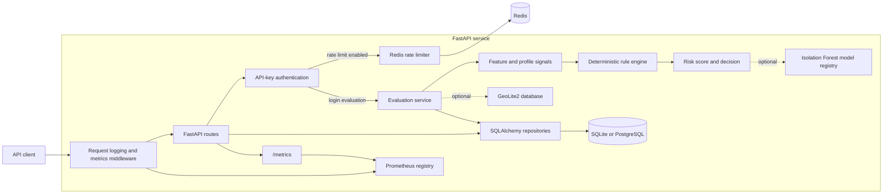

# Architecture

The diagram shows the request path and optional integrations. The API can run with
SQLite and no model or GeoIP database; PostgreSQL and Redis are available in the
local Compose stack.

Protected endpoints require `X-API-Key`. Login evaluation reads recent events
and user profiles, applies rule-based scoring, optionally blends a trained
model score, then persists the event and any eligible trusted-login profile
update. Feedback and risk-history requests use the same relational database.
Redis is contacted for API-key rate limiting only when that feature is enabled.

See the interactive [OpenAPI documentation](http://127.0.0.1:8000/docs) for
request and response examples. The API uses reserved documentation IP ranges
and synthetic identifiers in its examples; replace them with suitable test data.
